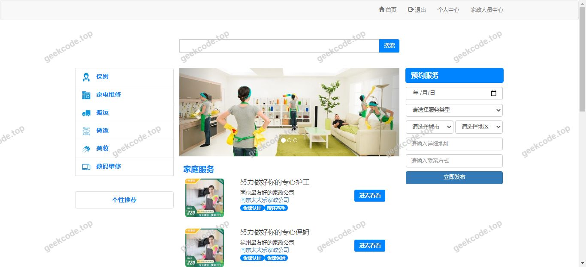
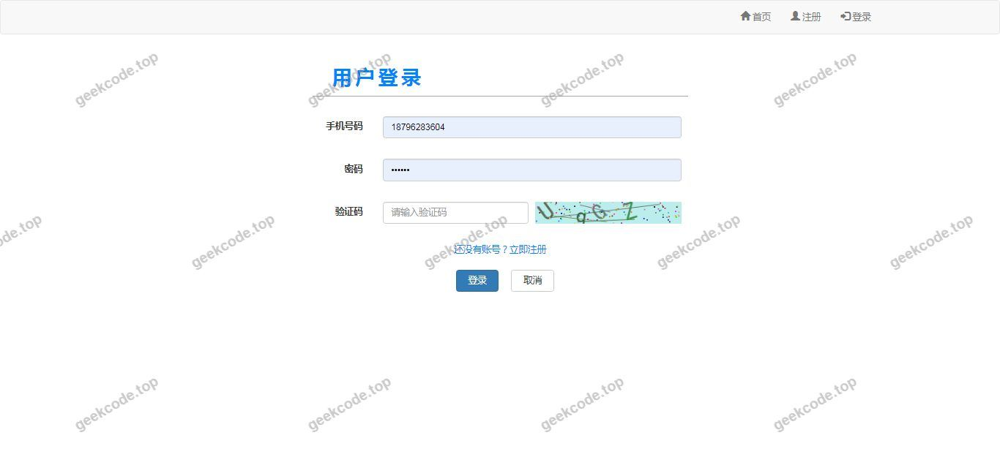
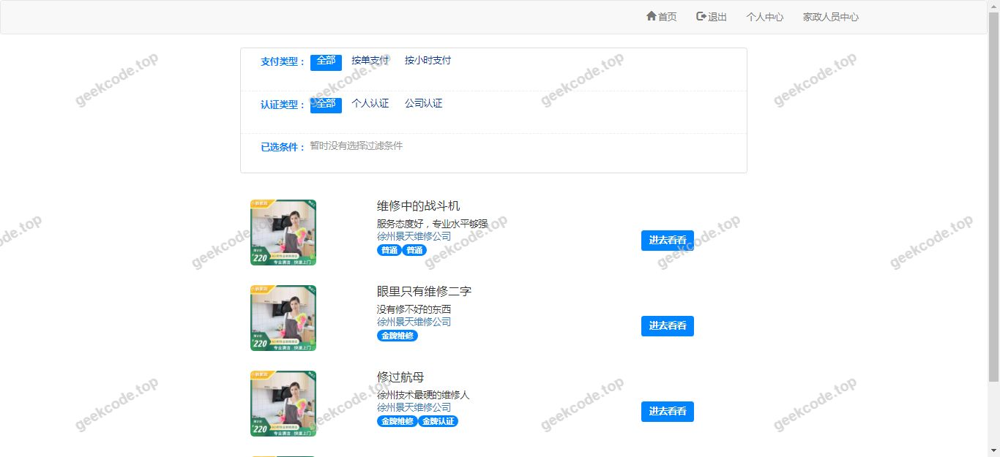
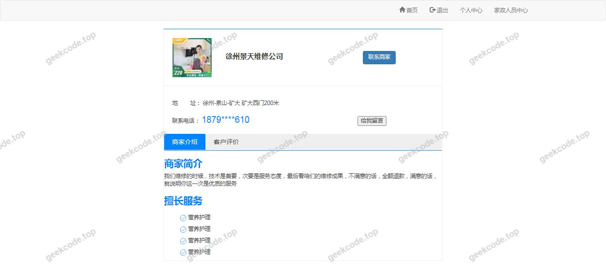
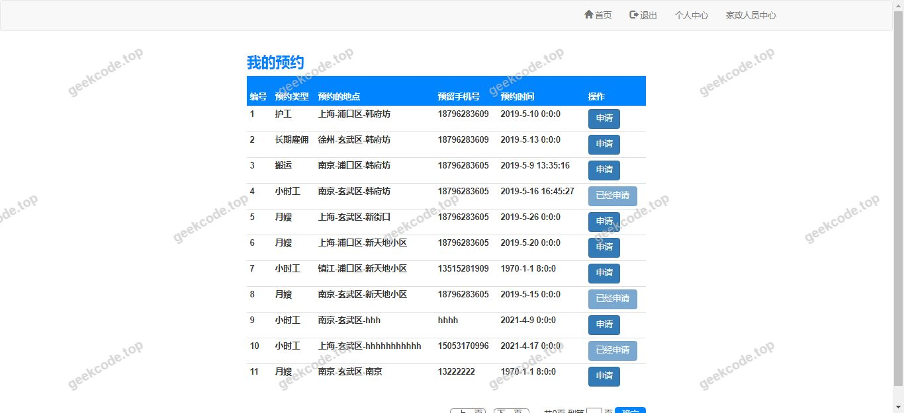
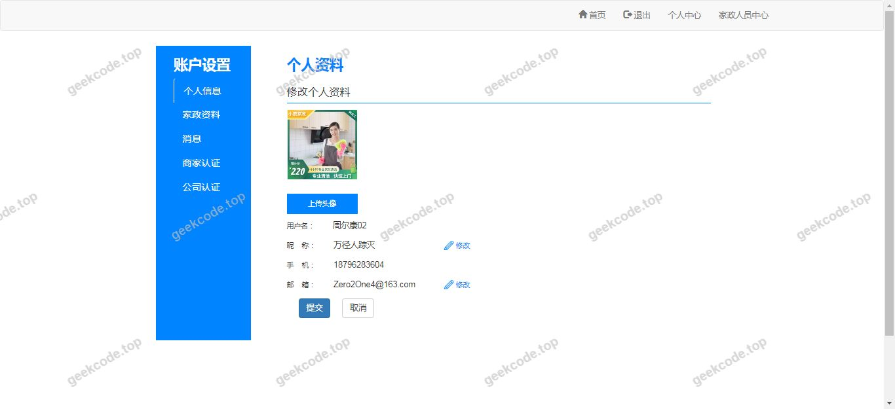
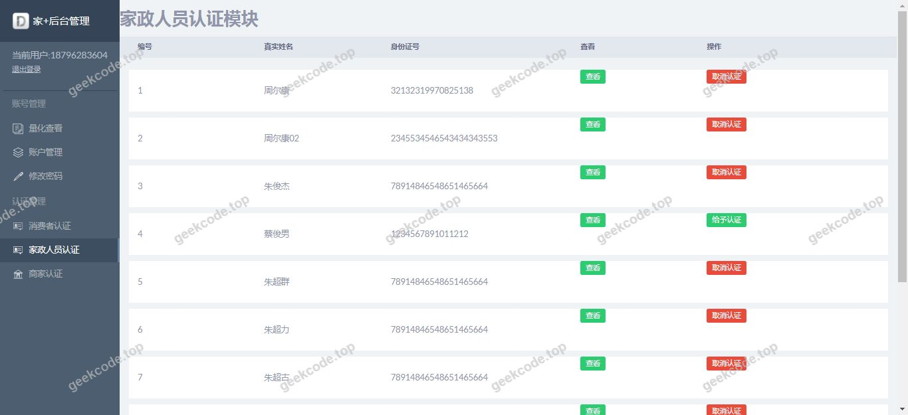

# java精品项目-基于ssm家政服务网站系统-18

> 🎓 **计算机毕业设计 · java精品项目-基于ssm家政服务网站系统-18**
>
> 本仓库只放**项目介绍 + 运行截图**（截图是站点带水印的原图，存在仓库 `images/` 里）。
>
> 👉 **完整可运行源码 / 数据库脚本 / 部署文档：[点我获取](https://geekcode.top/archives/java%E7%B2%BE%E5%93%81%E9%A1%B9%E7%9B%AE-%E5%9F%BA%E4%BA%8Essm%E5%AE%B6%E6%94%BF%E6%9C%8D%E5%8A%A1%E7%BD%91%E7%AB%99%E7%B3%BB%E7%BB%9F-18?utm_source=github)**
>
> 💬 咨询微信：**ir9372**　|　🌐 更多项目：[极客代码 geekcode.top](https://geekcode.top/?utm_source=github)
>
> 📌 项目详情页：<https://geekcode.top/archives/java%E7%B2%BE%E5%93%81%E9%A1%B9%E7%9B%AE-%E5%9F%BA%E4%BA%8Essm%E5%AE%B6%E6%94%BF%E6%9C%8D%E5%8A%A1%E7%BD%91%E7%AB%99%E7%B3%BB%E7%BB%9F-18?utm_source=github>

<table><td width="230" align="center"> <b>扫码加微信 ir9372</b></td><td valign="middle">📦 源码 = 项目介绍 + 全部运行截图 + 数据库 + 部署文档 👉 点上方任意截图，直接跳到 <b>极客代码 geekcode.top</b> 详情页</td></table>

---

<h1>java精品项目-基于ssm家政服务网站系统-18</h1>
<h2>项目概述</h2>

本项目为基于 SSM（Spring + Spring MVC + MyBatis）框架开发的家政服务网站系统。项目旨在构建一个连接家政服务人员、家政公司与用户的管理平台，实现服务预约、订单处理及人员信息管理等功能。核心功能涵盖管理员对系统的整体配置、家政公司入驻与管理、家政服务人员档案维护、用户注册登录以及在线服务预约与订单跟踪。适用人群包括需要寻找家政服务的普通用户、提供服务的家政公司及从业人员，以及负责审核与管理的系统管理员。技术架构上采用经典的 Java Web 三层架构，通过 Thymeleaf 模板引擎渲染前端页面，后端使用 Spring 进行业务逻辑管理，MyBatis 负责数据持久化操作，数据库选用 MySQL，并通过 Druid 连接池优化数据库访问性能。

<h2>技术架构</h2>
<h3>前后端架构</h3>

本项目采用传统的服务端渲染模式（Server-Side Rendering），而非前后端分离架构。

<ul>
<li><strong>表现层</strong>：使用 Thymeleaf 作为模板引擎，结合 HTML/CSS/JavaScript 构建用户界面。Controller 层返回视图名称，由 Thymeleaf 解析并生成最终 HTML 页面响应给浏览器。</li>
<li><strong>控制层</strong>：基于 Spring MVC 框架，通过 <code>@Controller</code> 和 <code>@RequestMapping</code> 注解定义路由规则，接收 HTTP 请求并调用 Service 层方法。</li>
<li><strong>业务逻辑层</strong>：使用 Spring Framework 的 IoC 容器管理 Bean，通过事务注解（如 <code>@Transactional</code>）保证业务操作的原子性。</li>
<li><strong>数据访问层</strong>：采用 MyBatis 框架，通过 XML 映射文件或注解定义 SQL 语句，实现对象关系映射（ORM）。</li>
</ul>
<h3>核心技术选型理由</h3>
<ol>
<li><strong>Spring &amp; Spring MVC</strong>：成熟的企业级开发框架，提供依赖注入和解耦能力，简化 Web 开发流程。</li>
<li><strong>MyBatis</strong>：轻量级 ORM 框架，SQL 灵活可控，便于优化复杂查询，适合中小型管理系统。</li>
<li><strong>Druid</strong>：阿里巴巴开源的高性能 JDBC 连接池，具备监控功能，能有效提升数据库连接复用率并防止连接泄漏。</li>
<li><strong>Thymeleaf</strong>：自然模板引擎，HTML 文件可直接在浏览器中预览，开发体验良好，且与 Spring Boot/SSM 集成度高。</li>
</ol>
<h3>数据库设计要点</h3>

虽然未提供具体表结构截图，但根据 Controller 列表（<code>Admin</code>, <code>Company</code>, <code>HKPerson</code>, <code>Order</code>, <code>User</code> 等）推断，数据库主要包含以下实体关系：

<ul>
<li><strong>用户表 (User)</strong>：存储普通注册用户信息。</li>
<li><strong>管理员表 (Admin)</strong>：存储后台管理人员账号。</li>
<li><strong>家政公司表 (Company)</strong>：记录入驻公司的基本信息。</li>
<li><strong>家政人员表 (HKPerson)</strong>：关联公司，存储服务人员技能、状态等信息。</li>
<li><strong>订单/预约表 (Order/Appointment)</strong>：记录用户发起的服务请求、状态流转及服务详情。</li>
<li><strong>消息表 (Message)</strong>：用于系统通知或用户留言反馈。</li>
</ul>
<h2>功能模块</h2>

根据代码上下文中的 Controller 类名及项目名称，系统主要功能模块划分如下：

<h3>前台用户端功能</h3>

尽管元数据标记“是否有前台: 否”，但存在 <code>IndexController</code>, <code>UserController</code>, <code>AppointmentController</code>, <code>OrderController</code> 等控制器，且截图显示有“系统运行界面”，表明存在面向用户的交互页面。推测主要功能包括：

<ol>
<li><strong>首页展示 (<code>IndexController</code>)</strong>：展示家政服务推荐、最新公告或热门公司信息。</li>
<li><strong>用户中心 (<code>UserController</code>)</strong>：</li>
</ol>
<ul>
<li>用户注册与登录。</li>
<li>个人信息修改与维护。</li>
<li>查看我的订单。</li>
</ul>
<ol start="3">
<li><strong>服务预约 (<code>AppointmentController</code>)</strong>：</li>
</ol>
<ul>
<li>浏览可预约的家政服务类型。</li>
<li>选择服务人员或公司进行预约下单。</li>
</ul>
<ol start="4">
<li><strong>订单管理 (<code>OrderController</code>)</strong>：</li>
</ol>
<ul>
<li>查看历史订单状态（待服务、进行中、已完成、已取消）。</li>
<li>订单评价或反馈。</li>
</ul>
<ol start="5">
<li><strong>消息互动 (<code>MessageController</code>)</strong>：</li>
</ol>
<ul>
<li>接收系统通知或客服回复。</li>
</ul>
<h3>后台管理端功能</h3>

尽管元数据标记“是否有后台: 否”，但存在 <code>AdminController</code>, <code>CompanyController</code>, <code>HKPersonController</code>, <code>ResultController</code> 等控制器，通常这些是管理员操作的核心入口。推测主要功能包括：

<ol>
<li><strong>管理员登录与管理 (<code>AdminController</code>)</strong>：</li>
</ol>
<ul>
<li>管理员身份验证。</li>
<li>系统基础参数配置。</li>
</ul>
<ol start="2">
<li><strong>家政公司管理 (<code>CompanyController</code>)</strong>：</li>
</ol>
<ul>
<li>审核新入驻的家政公司资质。</li>
<li>编辑或删除公司信息。</li>
<li>查看公司关联的服务人员列表。</li>
</ul>
<ol start="3">
<li><strong>家政人员管理 (<code>HKPersonController</code>)</strong>：</li>
</ol>
<ul>
<li>录入或更新家政服务人员档案（姓名、技能、所属公司等）。</li>
<li>管理人员工作状态（在职、休假等）。</li>
</ul>
<ol start="4">
<li><strong>结果/数据统计 (<code>ResultController</code>)</strong>：</li>
</ol>
<ul>
<li>可能涉及订单统计报表、用户增长数据分析或预约成功率展示。</li>
</ul>
<ol start="5">
<li><strong>全局订单监管 (<code>OrderController</code> - 后台视角)</strong>：</li>
</ol>
<ul>
<li>查看所有用户提交的订单。</li>
<li>处理异常订单或退款申请。</li>
</ul>

<em>(注：由于元数据明确标注无前台/后台路由菜单，以上模块划分严格依据 Controller 命名惯例及典型家政系统设计推导，具体页面跳转逻辑以实际代码为准。)</em>

<h2>用户角色与权限</h2>

根据 Controller 类的职责划分，系统主要涉及以下三类角色：

<table>
<thead>
<tr>
<th align="left">角色</th>
<th align="left">对应控制器/模块</th>
<th align="left">权限描述</th>
</tr>
</thead>
<tbody><tr>
<td align="left"><strong>超级管理员</strong></td>
<td align="left"><code>AdminController</code>, <code>ResultController</code></td>
<td align="left">拥有系统最高权限。可登录后台，管理所有家政公司审核、查看所有用户数据、查看系统统计结果、配置系统基础信息。</td>
</tr>
<tr>
<td align="left"><strong>家政公司/服务人员</strong></td>
<td align="left"><code>CompanyController</code>, <code>HKPersonController</code></td>
<td align="left"><em>(注：若系统未区分独立登录入口，则此部分由管理员代为维护；若有独立入口，则</em>) 可查看和管理本公司下的服务人员档案，确认接单情况。<em>根据现有代码仅见 AdminController，推测主要由管理员代为维护此类数据，或通过特定接口开放有限权限。</em></td>
</tr>
<tr>
<td align="left"><strong>普通用户</strong></td>
<td align="left"><code>UserController</code>, <code>AppointmentController</code>, <code>OrderController</code></td>
<td align="left">只能访问前台页面。权限包括：注册登录、浏览服务、发起预约、查看自己的订单状态、修改个人资料、发送消息。无法访问其他用户数据或后台管理功能。</td>
</tr>
</tbody></table>

<strong>权限控制机制</strong>：
系统可能通过拦截器（Interceptor）或过滤器（Filter）检查 Session 中的用户标识，限制非管理员访问 <code>Admin</code> 相关路径，限制未登录用户访问 <code>User</code> 或 <code>Order</code> 相关路径。

<h2>项目特色与创新点</h2>
<ol>
<li><strong>经典稳定的技术栈</strong>：采用 SSM + Thymeleaf 组合，避免了前后端分离带来的跨域问题和复杂的 API 调试，对于毕业设计而言，架构清晰，易于理解和部署，符合高校教学标准。</li>
<li><strong>数据访问优化</strong>：引入 Alibaba Druid 连接池替代传统的 C3P0 或 DBCP，不仅提升了高并发下的数据库连接效率，还提供了内置的监控页面（StatViewServlet），方便开发者实时监控 SQL 执行情况和系统健康状况。</li>
<li><strong>模块化设计</strong>：通过 BaseController 提取公共逻辑，各业务 Controller 继承或引用，实现了代码复用。将“公司”、“人员”、“订单”、“预约”解耦为独立的 Controller，便于后期维护和功能扩展。</li>
<li><strong>完整的业务闭环</strong>：涵盖了从“用户注册 -&gt; 浏览服务 -&gt; 在线预约 -&gt; 订单生成 -&gt; 服务完成 -&gt; 结果统计”的全生命周期管理，真实模拟了家政行业的业务流程。</li>
</ol>
<h2>部署环境</h2>

为确保项目正常运行，需准备以下软件环境：

<ol>
<li><strong>操作系统</strong>：Windows 7/10/11, Linux (CentOS/Ubuntu), 或 macOS。</li>
<li><strong>JDK 版本</strong>：建议 JDK 8 或 JDK 11（鉴于使用了较新的 Spring 版本特性，需兼容相应 JDK）。</li>
<li><strong>Web 服务器</strong>：Apache Tomcat 8.5 或 9.0+（支持 Servlet 3.1+/JSP 2.3+）。</li>
<li><strong>数据库</strong>：MySQL 5.7 或 MySQL 8.0。需初始化对应的建表脚本和数据填充脚本。</li>
<li><strong>开发工具</strong>：IntelliJ IDEA 或 Eclipse。</li>
<li><strong>构建工具</strong>：Maven 3.6+（用于管理 pom.xml 中的 junit, spring-context, mybatis 等依赖）。</li>
<li><strong>浏览器</strong>：Chrome, Firefox, Edge 等现代浏览器（支持 HTML5/CSS3）。</li>
</ol>

<strong>启动步骤简述</strong>：

<ol>
<li>导入 Maven 项目，下载依赖。</li>
<li>创建 MySQL 数据库，执行 SQL 脚本。</li>
<li>修改配置文件（如 <code>application.properties</code> 或 <code>jdbc.properties</code>）中的数据库 URL、用户名和密码。</li>
<li>配置 Tomcat 服务器并部署项目。</li>
<li>启动 Tomcat，访问 <code>http://localhost:8080/[项目名]</code> 进入系统首页。</li>
</ol>
<h2>五、技术特性</h2>
<ul>
<li>服务端模板渲染（Thymeleaf）</li>
</ul>
<h2>六、功能模块截图</h2>
<h3>前台用户端</h3>
<h4>系统运行界面1</h4>

<h4>系统运行界面2</h4>

<h4>系统运行界面3</h4>

<h4>系统运行界面4</h4>

<h4>系统运行界面5</h4>

<h4>系统运行界面6</h4>

<h4>系统运行界面7</h4>

---

## 获取完整源码

| 项目 | 说明 |
| --- | --- |
| 项目名 | java精品项目-基于ssm家政服务网站系统-18 |
| 运行截图 | 本文 7 张（站点带水印原图，仓库 `images/` 目录） |
| 完整源码 | [https://geekcode.top/archives/java%E7%B2%BE%E5%93%81%E9%A1%B9%E7%9B%AE-%E5%9F%BA%E4%BA%8Essm%E5%AE%B6%E6%94%BF%E6%9C%8D%E5%8A%A1%E7%BD%91%E7%AB%99%E7%B3%BB%E7%BB%9F-18?utm_source=github](https://geekcode.top/archives/java%E7%B2%BE%E5%93%81%E9%A1%B9%E7%9B%AE-%E5%9F%BA%E4%BA%8Essm%E5%AE%B6%E6%94%BF%E6%9C%8D%E5%8A%A1%E7%BD%91%E7%AB%99%E7%B3%BB%E7%BB%9F-18?utm_source=github) |
| 咨询微信 | **ir9372**（备注：jingpin-yuanma） |
| 更多项目 | [极客代码 geekcode.top](https://geekcode.top/?utm_source=github) |

> 需要源码、部署、改配置、跑不起来等问题，加微信 ir9372 沟通，说明项目名即可。
